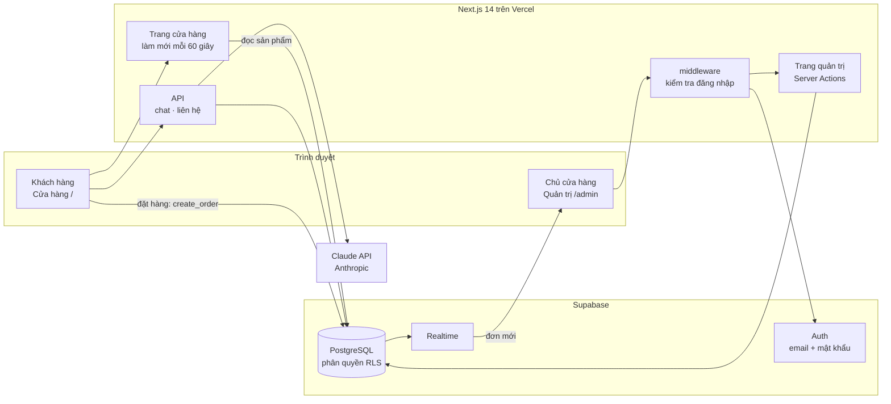
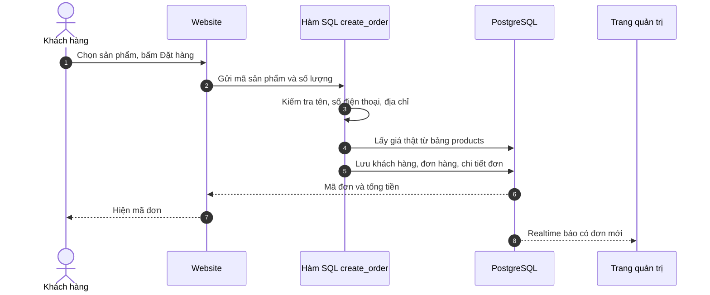
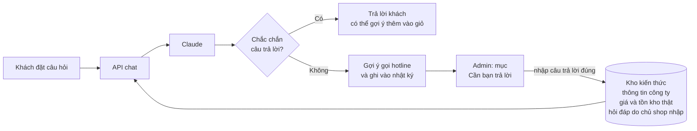
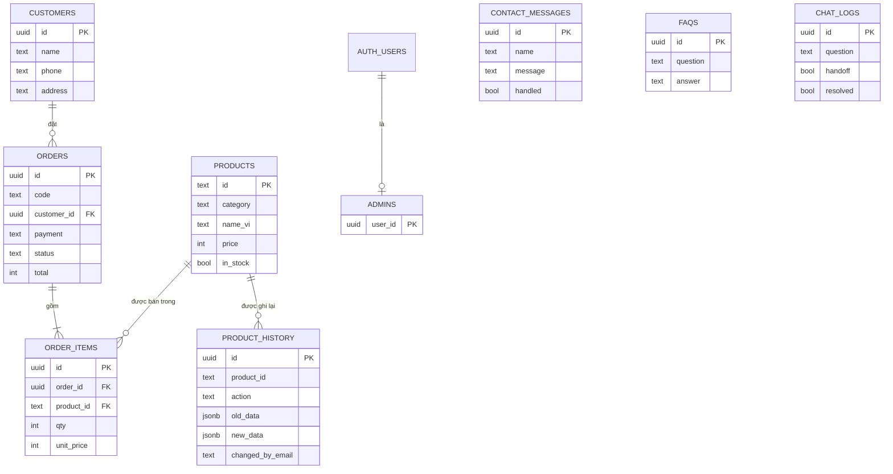
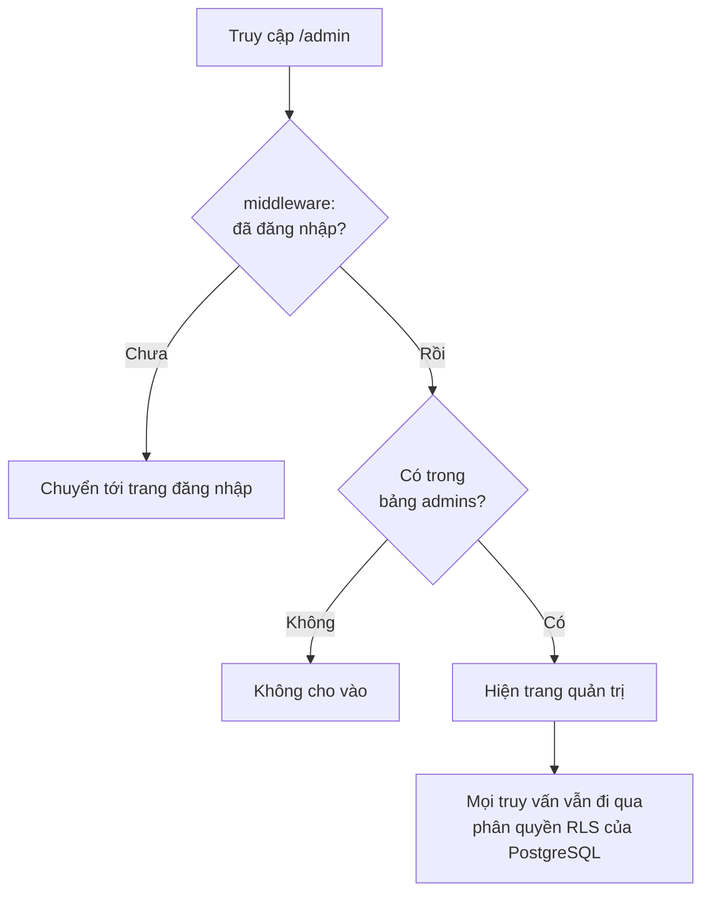
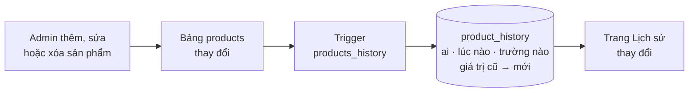

<div align="center">


<h1>Cacao Origin · Trọng Đức Cacao</h1>

<p><b>Website bán hàng song ngữ Việt/Anh kèm hệ thống quản trị<br>
cho Công ty TNHH Cacao Trọng Đức (Đồng Nai), thương hiệu bột cacao Vinchoco và sô-cô-la Bungo.</b></p>

<p>
  
  
  
  
  
</p>

<p>
  <a href="#giới-thiệu">Giới thiệu</a> ·
  <a href="#tính-năng">Tính năng</a> ·
  <a href="#kiến-trúc">Kiến trúc</a> ·
  <a href="#chạy-nhanh">Chạy nhanh</a> ·
  <a href="#chạy-đầy-đủ-với-supabase">Chạy đầy đủ</a> ·
  <a href="#trải-nghiệm-trong-5-phút">Trải nghiệm 5 phút</a>
</p>

</div>

| Website demo | Trang quản trị | Video demo | Mã nguồn |
|:---:|:---:|:---:|:---:|
| [điền địa chỉ Vercel] | [địa chỉ web]/admin | [điền link video] | [GitHub](https://github.com/thao1123lls-code/CacaoTrongDuc) |

<div align="center">

| 21 sản phẩm | 13 chứng nhận | 2 ngôn ngữ | 6 trang quản trị | Thời gian thực |
|:---:|:---:|:---:|:---:|:---:|
| bột cacao, sô-cô-la | OCOP, ISO, giải thưởng | Việt / Anh | tổng quan, đơn, khách, sản phẩm, liên hệ, chatbot | đơn mới báo ngay |

</div>

## Giới thiệu

**Bối cảnh.** Cacao Trọng Đức đồng hành cùng nông dân Đồng Nai từ năm 2005 và có nhiều chứng nhận (OCOP, sản phẩm công nghiệp nông thôn tiêu biểu, ISO 22000). Công ty cần một nơi để khách hàng **thấy được nguồn gốc và chứng nhận của sản phẩm**, **đặt hàng trực tuyến**, và để chủ cửa hàng **quản lý đơn hàng, khách hàng, sản phẩm** mà không phải dùng sổ sách hay bảng tính rời rạc.

**Giải pháp.** Một ứng dụng web gồm hai phần dùng chung một cơ sở dữ liệu:

| | Cửa hàng (`/`) | Quản trị (`/admin`) |
|---|---|---|
| **Dành cho** | Khách hàng | Chủ cửa hàng |
| **Làm được gì** | Xem sản phẩm, tự đóng hộp quà, đặt hàng, hỏi chatbot | Theo dõi doanh thu, xử lý đơn, quản lý sản phẩm, huấn luyện chatbot |

## Tính năng

### Dành cho khách hàng
- Giao diện song ngữ Việt/Anh, dùng tốt trên điện thoại.
- 21 sản phẩm, trang chi tiết (khối lượng, thành phần, hạn dùng, bảo quản), giỏ hàng, đặt hàng (COD hoặc chuyển khoản).
- **Tự tay đóng hộp quà**: chọn tối đa 7 thanh sô-cô-la, viết lời chúc, giá tự cộng theo từng thanh.
- **Túi bột cacao 3D** xoay được, hạt cacao bay quanh (WebGL tự viết, không dùng thư viện 3D; máy không hỗ trợ thì hiện ảnh tĩnh).
- **Hành trình hạt cacao** (đồ họa SVG), **vùng nguyên liệu**, **13 chứng nhận và giải thưởng** xem phóng to được, các dịch vụ của công ty.
- **Chatbot tư vấn** biết thông tin công ty, giá và tồn kho thật; gặp câu không chắc sẽ gợi ý gọi hotline.
- SEO và chia sẻ mạng xã hội: Open Graph, JSON-LD, `sitemap.xml`, `robots.txt`.

### Dành cho chủ cửa hàng
- **Tổng quan**: doanh thu, số đơn, giá trị đơn trung bình, khách hàng (so với kỳ trước), biểu đồ theo ngày, trạng thái đơn, hình thức thanh toán, sản phẩm bán chạy, khách chi tiêu nhiều nhất. Chọn 7, 30 hoặc 90 ngày.
- **Đơn hàng**: tìm kiếm, lọc theo trạng thái, đổi trạng thái, **xuất CSV**, **báo đơn mới ngay lập tức** (Supabase Realtime).
- **Khách hàng**: gộp theo số điện thoại, số đơn, tổng chi tiêu.
- **Sản phẩm**: thêm, sửa, xóa; sửa nhanh giá và còn hàng/hết hàng.
- **Lịch sử thay đổi sản phẩm**: ghi lại *ai*, *lúc nào*, đổi *trường nào từ gì sang gì*.
- **Tin nhắn liên hệ**: xem và đánh dấu đã xử lý.
- **Huấn luyện chatbot**: xem câu khách hỏi mà chatbot chưa chắc, nhập câu trả lời đúng để lần sau chatbot trả lời được.

<!--
## Ảnh chụp màn hình
Thêm ảnh vào thư mục docs/screenshots/ rồi bỏ dấu chú thích bao quanh đoạn này.

| Trang chủ | Hộp quà | Chatbot |
|:---:|:---:|:---:|
|  |  |  |

| Tổng quan quản trị | Đơn hàng | Lịch sử sản phẩm |
|:---:|:---:|:---:|
|  |  |  |
-->

## Kiến trúc

Toàn bộ ứng dụng nằm trong một dự án Next.js. Dữ liệu, đăng nhập và thông báo thời gian thực do Supabase đảm nhiệm.



### Luồng đặt hàng

Khách **không bao giờ gửi giá**. Máy chủ cơ sở dữ liệu tự tính lại giá từ bảng sản phẩm.



### Chatbot tự học từ chủ cửa hàng



### Cơ sở dữ liệu



## Chạy nhanh

Chế độ demo, **không cần cấu hình gì**. Yêu cầu: **Node.js 18.17 trở lên** ([nodejs.org](https://nodejs.org), bản LTS).

```bash
git clone https://github.com/thao1123lls-code/CacaoTrongDuc.git
cd CacaoTrongDuc
npm install
npm run dev
```

Mở **http://localhost:3000**.

> [!NOTE]
> Ở chế độ demo, website dùng dữ liệu sản phẩm có sẵn trong mã nguồn. Đặt hàng và form liên hệ chỉ báo thành công chứ **không lưu**, trang `/admin` hiện hướng dẫn cấu hình, chatbot trả lời theo bộ hỏi đáp có sẵn. Muốn thử đầy đủ, làm tiếp phần dưới hoặc dùng website demo ở đầu trang.

## Chạy đầy đủ với Supabase

Có dữ liệu thật, trang quản trị và chatbot AI.

### Bước 1. Tạo cơ sở dữ liệu

Tạo dự án miễn phí tại [supabase.com](https://supabase.com), vào **SQL Editor → New query**, chạy **lần lượt** từng file trong thư mục `supabase/` (mở file, sao chép toàn bộ nội dung, bấm Run):

| Thứ tự | File | Tác dụng |
|:---:|---|---|
| 1 | `schema.sql` | Bảng, phân quyền (RLS), hàm đặt hàng `create_order` |
| 2 | `seed.sql` | 21 sản phẩm |
| 3 | `product-details.sql` | Cột thông tin chi tiết sản phẩm |
| 4 | `contacts.sql` | Bảng tin nhắn liên hệ |
| 5 | `chatbot.sql` | Bảng hỏi đáp và nhật ký chatbot |
| 6 | `product-history.sql` | Lịch sử thay đổi sản phẩm |
| 7 | `seed-customers.sql`, `seed-orders.sql`, `seed-contacts.sql` | *Tùy chọn.* Dữ liệu mẫu: 20 khách, khoảng 40 đơn, 10 tin nhắn, để biểu đồ có số liệu |

### Bước 2. Tạo tài khoản quản trị

1. **Authentication → Users → Add user**: nhập email và mật khẩu.
2. Cấp quyền admin trong SQL Editor (thay email của bạn):
   ```sql
   insert into public.admins (user_id)
   select id from auth.users where email = 'email-cua-ban@example.com';
   ```

### Bước 3. Khai báo khóa

Sao chép `.env.example` thành `.env.local` (Windows: `copy .env.example .env.local`), bỏ dấu `#` ở các dòng cần dùng và điền giá trị lấy ở **Project Settings → API**:

| Biến | Ý nghĩa | Bắt buộc |
|---|---|:---:|
| `NEXT_PUBLIC_SUPABASE_URL` | Project URL | Có |
| `NEXT_PUBLIC_SUPABASE_ANON_KEY` | Khóa `anon public` (hoặc `publishable`). **Không** dùng `service_role` | Có |
| `NEXT_PUBLIC_SITE_URL` | Địa chỉ web, ví dụ `http://localhost:3000` | Không |
| `ANTHROPIC_API_KEY` | Bật chatbot trả lời bằng AI | Không |

### Bước 4. Chạy

```bash
npm run dev
```

Cửa hàng: http://localhost:3000 · Quản trị: http://localhost:3000/admin/login

> [!TIP]
> Sau khi sửa `.env.local` phải dừng (Ctrl+C) rồi chạy lại `npm run dev`.

**Đưa lên mạng:** đẩy mã lên GitHub, nhập repository vào [Vercel](https://vercel.com), khai báo các biến môi trường như trên rồi bấm Deploy. Trong Supabase → Authentication → URL Configuration, thêm địa chỉ web thật vào Site URL.

## Tài khoản cho giám khảo

Tài khoản này chỉ dùng để xem trang quản trị của website demo.

| | |
|---|---|
| Địa chỉ | http://localhost:3000/admin/login |
| Email | thao1.123lls@gmail.com |
| Mật khẩu | thao123@@ |

## Trải nghiệm trong 5 phút

| # | Làm gì | Xem được gì |
|:---:|---|---|
| 1 | **Trang chủ**: cuộn qua túi 3D, hành trình, vùng nguyên liệu, chứng nhận. Bấm nút **EN** | Đồ họa 3D, song ngữ, chứng nhận xem phóng to |
| 2 | Thêm sản phẩm vào giỏ, thử **Tự tay đóng hộp quà** | Chọn thanh, lời chúc, giá tự cộng |
| 3 | Bấm **Giỏ hàng → Đặt hàng**, điền thông tin | Đơn hàng được lưu với mã đơn |
| 4 | Hỏi **chatbot**: "Bột cacao nào còn hàng, giá bao nhiêu?" | Trả lời theo dữ liệu thật |
| 5 | Đăng nhập `/admin/login` | **Đơn vừa đặt hiện ngay**, không cần tải lại trang |
| 6 | Vào **Đơn hàng**: đổi trạng thái, xuất CSV | Quản lý đơn |
| 7 | Vào **Sản phẩm**: đổi giá, bấm **Lịch sử thay đổi** | Ai đổi gì, lúc nào |
| 8 | Vào **Huấn luyện chatbot** | Câu hỏi khách chưa được trả lời, nhập đáp án |

## Bảo mật

Nhiều lớp bảo vệ độc lập, để một lớp bị vượt qua thì dữ liệu vẫn an toàn.



Lịch sử thay đổi sản phẩm do cơ sở dữ liệu tự ghi, trình duyệt không thể giả mạo:



- **Giá không thể bị khách sửa**: đặt hàng đi qua hàm SQL `create_order`, hàm này kiểm tra thông tin khách và tự tính lại giá ở máy chủ.
- **Phân quyền ở tầng cơ sở dữ liệu (RLS)**: khách chỉ đọc được sản phẩm; đơn hàng, khách hàng, lịch sử chỉ tài khoản trong bảng `admins` mới đọc và sửa được. Mã nguồn không dùng khóa `service_role`.
- **Lịch sử không thể giả mạo**: trigger `security definer` tự ghi vào `product_history`; bảng này không có quyền ghi từ trình duyệt, ngay cả admin cũng không sửa hay xóa được.
- **Chống spam form liên hệ**: ô ẩn (honeypot), thời gian điền tối thiểu, giới hạn số lần gửi theo IP, giới hạn đường link trong nội dung.

## Công nghệ

| Thành phần | Công nghệ |
|---|---|
| Giao diện, máy chủ | Next.js 14 (App Router), React 18, TypeScript |
| Cơ sở dữ liệu, đăng nhập, thời gian thực | Supabase (PostgreSQL, Auth, Row Level Security, Realtime) |
| Biểu đồ | Recharts |
| Đồ họa 3D | WebGL tự viết (`src/lib/cacao3d.ts`), không phụ thuộc thư viện ngoài |
| Chatbot | API Claude của Anthropic (tùy chọn) và bộ hỏi đáp có sẵn |
| Triển khai | Vercel |

<details>
<summary><b>Cấu trúc thư mục</b></summary>

```
supabase/                       Các file SQL (bảng, phân quyền, hàm, dữ liệu mẫu)
src/app/(shop)/                 Trang cửa hàng: trang chủ, chi tiết sản phẩm
src/app/admin/                  Đăng nhập, tổng quan, đơn hàng, khách hàng,
                                sản phẩm (+ lịch sử), liên hệ, huấn luyện chatbot
src/app/api/                    API chatbot và form liên hệ
src/components/                 Giao diện cửa hàng (3D, hộp quà, chứng nhận, chatbot...)
src/components/admin/           Biểu đồ và thành phần quản trị
src/lib/                        Kiểu dữ liệu, song ngữ, thống kê, kho kiến thức chatbot
public/images/                  Ảnh sản phẩm, chứng nhận, vùng nguyên liệu
```

</details>

<details>
<summary><b>Hạn chế hiện tại và hướng phát triển</b></summary>

- Thanh toán chuyển khoản mới chỉ ghi nhận hình thức, chưa tích hợp cổng thanh toán hay mã QR tự động.
- Chưa có thông báo đơn mới qua email, Zalo hoặc Telegram (hiện báo trong trang quản trị).
- Tồn kho chỉ có trạng thái còn hàng/hết hàng, chưa quản lý theo số lượng.
- Mọi tài khoản admin có quyền như nhau, chưa có vai trò "nhân viên" chỉ xem và xử lý đơn.
- Ảnh sản phẩm nhập bằng đường dẫn, chưa tải lên trực tiếp.
- Thống kê tính trên tối đa 5.000 đơn của kỳ được chọn; lượng đơn lớn hơn nên chuyển sang view hoặc hàm SQL tổng hợp.
- Chưa có lịch sử cho đơn hàng và khách hàng (đã có cho sản phẩm).

</details>

<details>
<summary><b>Gặp lỗi khi chạy?</b></summary>

- **Trang hiện "Chưa cấu hình Supabase"**: thiếu hoặc sai tên biến trong `.env.local` (phải đúng là `NEXT_PUBLIC_SUPABASE_URL` và `NEXT_PUBLIC_SUPABASE_ANON_KEY`), hoặc chưa khởi động lại sau khi sửa.
- **`npm run build` báo lỗi tải font**: lệnh này cần Internet để tải Google Fonts. `npm run dev` không bị ảnh hưởng.
- **Không đăng nhập được `/admin`**: kiểm tra đã chạy lệnh `insert into public.admins ...` cho đúng email chưa.
- Không đưa `.env.local` lên GitHub hay gửi trong file nộp bài (đã được `.gitignore` chặn).

</details>

## Nhóm thực hiện

| Họ tên | Vai trò |
|---|---|
| Đinh Nguyễn Tường Nhi | Nhóm trưởng |
| Hoàng Phương Thảo | Thành viên |


